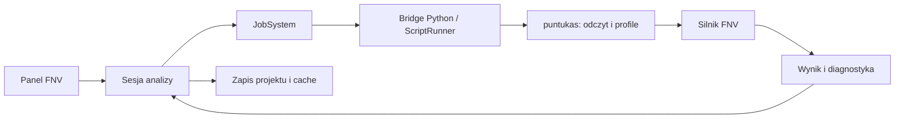

# Moduł poprawki FNV — przegląd i plan

Data: 2026-10-05. Status: plan, bez implementacji.

## Rekomendacja

Moduł powinien czytać dane przez `puntukas-tools2`, liczyć FNV w Pythonie, a w C++ zarządzać zadaniami, UI i wynikami. CHG/CHGCAR opisują gęstość elektronową; standardowa poprawka FNV wymaga potencjałów LOCPOT. Import gęstości służy diagnostyce i wizualizacji, ale nie musi blokować pierwszej wersji kalkulatora.

Sprawdzono graf projektu, istniejące bridge’y Python, zapis projektu oraz publiczne API lokalnego `puntukas 0.0.1`. Sygnatury i docstringi puntukas zweryfikowano przez introspekcję; nie wykonano jeszcze walidacji na rzeczywistych plikach CHG/CHGCAR/LOCPOT.

## 1. CHG, CHGCAR i przestrzenny rozkład ładunku

| Plik | Zawartość | Zastosowanie w module |
|---|---|---|
| CHG | Struktura i gęstość elektronowa na siatce; bez obsadzeń PAW, z mniejszą precyzją zapisu | Wizualizacja i diagnostyka |
| CHGCAR | Gęstość na siatce oraz obsadzenia jednocentrowe PAW; dodatkowe bloki magnetyzacji zależnie od obliczenia | Dokładniejsza analiza gęstości |
| LOCPOT | Potencjał lokalny w eV; jego skład zależy od ustawień VASP | Podstawowe wejście do FNV |
| WAVECAR | Binarne współczynniki funkcji falowych, dane pasm i obsadzeń | Analiza konkretnych orbitali |

CHG nie jest automatycznie gęstością pojedynczego orbitalu. Do gęstości wybranych pasm służy PARCHG.

Źródła: [formaty wyjściowe VASP](https://vasp.at/wiki/Output_files), [CHG](https://vasp.at/wiki/CHG), [LOCPOT](https://vasp.at/wiki/LOCPOT).

### Reprezentacja przestrzenna

Rozkład nie jest zapisany jako lista pozycji i wartości. Plik zawiera:

1. Nagłówek struktury w formacie POSCAR: wektory komórki i atomy.
2. Rozmiar siatki `Nx Ny Nz`.
3. `Nx × Ny × Nz` wartości.
4. Ewentualne dodatkowe bloki.

Położenie próbki o indeksach liczonych od zera:

```text
r(i,j,k) = (i/Nx) a + (j/Ny) b + (k/Nz) c
```

Siatka obejmuje komórkę okresową, także skośną. W pliku VASP najszybciej zmienia się indeks `x`. Dla surowych wartości `D`:

```text
Ngrid = Nx * Ny * Nz
Vcell = |a · (b × c)|
n(i,j,k) = D(i,j,k) / Vcell
Nelect = sum(D) / Ngrid
```

Adapter musi rozróżniać surowe wartości od już znormalizowanej gęstości. Dla kolinearnego spinowego CHGCAR pierwszy blok zawiera gęstość całkowitą, drugi magnetyzację. Dla obliczeń niekolinearnych występują trzy składowe magnetyzacji.

Źródło: [CHGCAR — format i normalizacja](https://vasp.at/wiki/CHGCAR). Dokumentacja VASP opisuje gęstość liczby elektronów w `1/ų`; docstring puntukas używa `e/ų`. Kontrakt adaptera powinien jawnie ustalić znaczenie i jednostkę, bez dodatkowego mnożenia przez znak ładunku elektronu.

To gęstość elektronowa, a nie kompletny rozkład netto obejmujący jony. Dodatni stan ładunkowy `q` oznacza usunięte elektrony. Nie wolno wyznaczać `q` przez prostą różnicę liczby elektronów między defektem a bulk, jeśli zmienił się skład atomowy.

## 2. Co liczy FNV

W okresowych obliczeniach naładowany defekt oddziałuje ze swoimi obrazami i tłem kompensującym. FNV koryguje energię przez porównanie ekranowanego modelu ładunku w układzie izolowanym i okresowym oraz dopasowanie jego potencjału do różnicy potencjałów DFT daleko od defektu.

Źródło: [Freysoldt, Neugebauer i Van de Walle, PRL 102, 016402 (2009)](https://harvest.aps.org/v2/journals/articles/10.1103/PhysRevLett.102.016402/fulltext).

### Wejścia

- LOCPOT idealnej superkomórki referencyjnej.
- LOCPOT defektu dla każdego `q`.
- Zgodne wektory superkomórki i definicja potencjału.
- Stan ładunkowy, środek defektu i przenikalność dielektryczna.
- Parametry modelu oraz tolerancje numeryczne.

Referencją jest idealna superkomórka odpowiadająca obliczeniu defektu, nie dowolna komórka prymitywna. Nie należy bez walidacji utożsamiać jej z katalogiem `bulkDirectory` projektu.

### Wynik i ograniczenia

Wynik rozdziela składnik elektrostatyczny, składnik dopasowania potencjału i sumę w eV. Konwencję znaków przejmujemy z przetestowanego silnika. Dopasowanie potencjału jest częścią poprawki — nie dodajemy go ponownie do energii formacji.

Automatyzacja musi oceniać jakość dopasowania. Brak stabilnego plateau daleko od defektu może oznaczać zbyt małą superkomórkę, delokalizację ładunku lub problem z referencją.

Dla silnie anizotropowych materiałów i struktur po relaksacji warto przewidzieć osobny wariant eFNV Kumagai–Oba, wykorzystujący potencjały przy atomach i tensor dielektryczny. Slaby i układy 2D wymagają odrębnego podejścia. Nie wolno po cichu zastępować tensora jego średnią i przedstawiać wyniku jako pełnej poprawki anizotropowej.

Źródło: [Kumagai–Oba, PRB 89, 195205 (2014)](https://arxiv.org/abs/1402.1226).

Wybór dielektryka musi uwzględniać rodzaj procesu: relaksowane stany równowagowe i przejścia pionowe nie mogą automatycznie otrzymywać tej samej konfiguracji ekranowania. MVP powinien jawnie określić obsługiwany przypadek fizyczny.

## 3. Wykorzystanie puntukas-tools2

Potwierdzone przez introspekcję lokalnego pakietu:

```python
from puntukas.vasp import Chgcar, Parchg, Locpot

density = Chgcar.from_file(path).charge_density()
potential = Locpot.from_file(path).potential()
```

`Chgcar.charge_density()` zwraca `puntukas.grid.field.ScalarField`.

| API ScalarField | Wykorzystanie |
|---|---|
| `data`, `cell`, `shape`, `atoms`, `meta` | Transport siatki i geometrii |
| `integrate()` | Kontrola liczby elektronów |
| `planar_average(axis)` | Profile do FNV |
| `slice_scaled(axis, offset)` | Przekroje w UI |
| `line(...)`, `interpolate(...)` | Próbkowanie pola |
| `radial_profile(...)` | Diagnostyka lokalizacji, z ograniczeniami geometrii opisanymi w dokumentacji |

CHGCAR zwraca podobny obiekt pola jak ścieżka WAVECAR po transformacji do przestrzeni rzeczywistej. Znaczenie wartości jest inne: obecny bridge WAVECAR przesyła rzeczywistą część funkcji falowej, a CHGCAR — gęstość elektronową. Nie należy przypisywać gęstości do pól energii i obsadzenia orbitalu tylko po to, żeby pasowała do istniejącego typu.

### Warunki walidacji

- `Parchg` deklaruje obsługę CHG, ale jego dokumentacja opisuje gęstość częściową. Adapter musi zachować semantykę rzeczywistego pliku.
- Docstring `Locpot.potential()` opisuje spinowe bloki jako total/magnetyzacja, podczas gdy VASP dla obliczeń kolinearnych opisuje up/down. Potrzebny test zgodności kanałów.
- Sprawdzić normalizację, orientację komórki, kolejność osi i zachowanie wieloblokowych plików.
- Dla skośnej komórki współrzędna profilu `planar_average` jest według docstringa pozycją wzdłuż wektora sieci, a nie ogólnie odległością prostopadłą do płaszczyzny. Adapter i wykresy muszą zachować konwencję silnika.

Nie potwierdzono kalkulatora FNV w sprawdzonym API puntukas. Na tym etapie wykorzystujemy puntukas jako czytnik i narzędzie obróbki pól.

## 4. Backend i dispatch

Istniejący [runtime Python](../../../python-runtime.md) używa `ScriptRunner` i subprocessów. Podobny przepływ jest już w [VaspOrbitalGridBridge](../../../../src/ScientificRuntime/Python/VaspOrbitalGridBridge.cpp) i skrypcie [vasp_orbital_grid_load.py](../../../../scripts/python/examples/vasp_orbital_grid_load.py).



### Minimalne nowe elementy

- `FnvRequest` i `FnvResult` w domenie.
- `FnvBridge` i `FnvJob` w `ScientificRuntime`.
- `FnvSession` oraz jeden panel w `Presentation`.
- Projektowy zapis konfiguracji i wyników.

Nazwy są propozycją, nie zatwierdzonym kontraktem. Reużyć istniejący wzorzec sesji i jobów, bez osobnej platformy wykonywania obliczeń.

### Biblioteki

| Warstwa | Wybór |
|---|---|
| C++ | Istniejące JobSystem, Result, StructuredError, Path, EventBus, ImGui, ImPlot, nlohmann/json i YAML |
| Czytanie i obróbka pól | puntukas i NumPy; SciPy tam, gdzie potrzebny |
| FNV | pymatgen-analysis-defects |
| Eksport wykresów | Matplotlib, już zadeklarowany w projekcie |

`pymatgen-analysis-defects` nie jest zainstalowany w sprawdzonym środowisku. Funkcja `get_freysoldt_correction` w sprawdzonej implementacji przyjmuje również słowniki profili planar average. Można zatem przekazać profile puntukas bez ponownego parsowania LOCPOT, z jawną komórką i środkiem defektu. Należy przypiąć i przetestować wersję adaptera oraz sprawdzić zgodność próbkowania, szczególnie okresowych końców osi.

Źródło: [implementacja freysoldt.py](https://raw.githubusercontent.com/materialsproject/pymatgen-analysis-defects/main/pymatgen/analysis/defects/corrections/freysoldt.py).

Obliczenia prowadzić w `float64`; do renderowania można przygotować `float32`. GPU i własny solver C++ pozostawić do momentu, gdy pomiary wykażą potrzebę.

### Seria stanów ładunkowych

Jeden proces może przygotować wspólną referencję i kolejno obsłużyć wiele `q`. Ograniczyć równoległość według pamięci: kilka pełnych LOCPOT może znacznie zwiększyć zużycie RAM.

- Snapshot konfiguracji przy dispatch; zmiany UI nie modyfikują trwającego zadania.
- Wyniki przypisane do stabilnego identyfikatora analizy i fingerprintu żądania.
- Odrzucanie spóźnionych wyników po zmianie konfiguracji.
- Błąd jednego stanu nie usuwa wyników pozostałych.
- Anulowanie i timeout przekazane aż do procesu; zweryfikować rzeczywiste podłączenie tych opcji w nowym bridge.
- Etapy postępu: walidacja, referencja, odczyt stanu, obliczenie, zapis.
- StructuredError, istniejące powiadomienia i logowanie zamiast samych komunikatów stdout.

## 5. UI i prezentacja informacji

Panel „Poprawka ładunkowa”:

| Część | Zawartość |
|---|---|
| Referencja | Bulk supercell, źródło dielektryka, rodzaj obliczenia, metoda |
| Seria obliczeń | Katalog, q, środek defektu, dostępność plików, stan zadania |
| Wyniki | Składniki poprawki, suma, diagnostyka i wykresy |

Akcje: „Oblicz brakujące/nieaktualne”, „Przelicz zaznaczone”, „Anuluj”, „Eksportuj”.

Tabela wyników: `q`, `E_electrostatic`, `E_alignment`, `E_corr`, jakość dopasowania i pochodzenie wyniku.

Szczegóły zaznaczonego wiersza:

- Trzy wykresy profili wzdłuż kierunków komórki.
- Różnica potencjałów DFT, potencjał modelu i reszta po odjęciu modelu.
- Zaznaczony obszar dopasowania.
- Rozrzut reszty i zgodność wyników między kierunkami.
- Źródła danych, parametry i wersje bibliotek.

Nazwy katalogów mogą sugerować `q`, ale nie są wiarygodnym źródłem. Automatyczne rozpoznanie korzysta z metadanych obliczenia albo pozostaje propozycją do potwierdzenia. Dla zmienionego składu potrzebna jest neutralna liczba elektronów właściwa dla danego defektu i zastosowanych potencjałów PAW.

### Wizualizacja gęstości

Opcjonalne przekroje, izopowierzchnie i różnice gęstości CHG/CHGCAR. Różnica między stanem naładowanym a neutralnym tego samego defektu jest łatwiejsza do interpretacji przy identycznej geometrii; po relaksacji zawiera także efekty przemieszczeń atomów.

Różne siatki wymagają jawnego, zweryfikowanego uzgodnienia próbkowania. Nie odejmować tablic tylko dlatego, że mają tę samą liczbę elementów.

Rozrzut plateau pokazywać jako diagnostykę dopasowania, nie jako pełną niepewność fizyczną poprawki.

## 6. Cache i trwały zapis

| Poziom | Zawartość |
|---|---|
| Cache źródła | Geometria, metadane i trzy profile potencjału |
| Cache obliczenia | Wynik FNV i dane wykresów |
| Cache wizualizacji | Opcjonalne siatki i meshe, z limitem pamięci |

Pełnych siatek nie przesyłać przez JSON. Reużyć schemat „JSON metadanych + plik binarny”, jawnie zapisując typ liczbowy, jednostki i kolejność indeksów. VASP ma x-fastest; istniejący transport orbitalu używa C-order z z-fastest. Adapter musi dokonać poprawnej konwersji.

### Inwalidacja

Klucz cache obejmuje:

- Fingerprint wszystkich istotnych plików źródłowych.
- Komórkę, kanał i definicję potencjału.
- `q`, dielektryk i środek defektu.
- Model, tolerancje oraz ustawienia dopasowania.
- Wersje parsera, silnika i schematu danych.

`mtime` i rozmiar służą do szybkiej kontroli; hash zawartości identyfikuje dane. Ograniczenie kontroli do metadanych musi być jawne, bo nie wykrywa wszystkich zmian. Zmiana pliku podczas odczytu unieważnia wynik. Wspólna referencja jest cache’owana raz dla wielu stanów; zmiana dielektryka nie powinna wymuszać ponownego parsowania źródła.

### Persistence

Trwały wynik naukowy to więcej niż cache: zapisujemy konfigurację, poprawkę, diagnostykę i provenance. Po ponownym otwarciu wynik może być widoczny nawet bez źródeł, ze statusem „niezweryfikowany” lub „źródła niedostępne”.

Projekt ma [ProjectManifest](../../../../src/IO/ProjectManifestIO.hpp), ale StorageLayer jest obecnie szkieletem. Proponowany mały zapis analizy w projekcie i osobny katalog danych pochodnych, bez nowej bazy danych. Zachować rozdział odpowiedzialności opisany w [ADR-004](../../../adr/ADR-004-storage-vs-io-split.md): persistence i własność danych należą do Storage, formaty i surowe odczyty/zapisy do IO.

Przykładowy układ, do dopasowania do aktualnych konwencji projektu:

```text
manifest.yaml
analyses/fnv/<analysis-id>/analysis.json
analyses/fnv/<analysis-id>/results/<request-hash>.json
cache/fnv/profiles/<source-hash>.bin
cache/volumetric/<source-hash>.bin
```

- W manifestach referencje do analiz, bez pełnych siatek.
- Ścieżki względne dla danych należących do projektu; mechanizm ponownego wskazania zewnętrznych źródeł.
- Zapisy atomowe, bez publikacji częściowego wyniku jako ukończonego.
- Cache można usuwać; zatwierdzonych wyników nie usuwać automatycznie razem z cache.
- Eksport CSV tabeli, JSON danych i provenance oraz wykresów przez istniejące narzędzia.
- Wynik FNV nie oznacza kompletnej energii formacji: ta wymaga także energii całkowitych i odpowiednich składników chemicznych oraz elektronowych.

## 7. Kolejność realizacji

1. Zweryfikować czytniki: CHG/CHGCAR, normalizacja, kolejność osi i kanały LOCPOT.
2. Policzyć jeden przypadek FNV z jawnym `q`, dielektrykiem i środkiem defektu; porównać z wynikiem referencyjnym.
3. Dodać serię stanów: wspólny bulk, joby, anulowanie i niezależne błędy wierszy.
4. Dodać wykresy i ocenę plateau.
5. Dodać cache oraz zapis/odczyt analizy.
6. Rozszerzyć diagnostykę gęstości i eFNV po zweryfikowaniu podstawowego wariantu.

### Warunki odbioru

- Zgodność komórek, ustawień i definicji potencjałów.
- Poprawne jednostki oraz brak podwójnej normalizacji.
- Siatka testowa o nierównych wymiarach wykrywająca zamianę osi.
- Testy całki gęstości i spinowych bloków.
- `q=0`, dodatnie i ujemne `q`; zgodność z referencją i konwencją znaków silnika.
- Rozpoznanie nieobsługiwanej anizotropii i układów 2D.
- Brak plateau widoczny w diagnostyce, bez bezwarunkowego statusu „poprawny”.
- Obsługa uszkodzonych i zmieniających się plików.
- Inwalidacja cache po zmianie źródeł, parametrów lub wersji silnika.
- Anulowanie procesu i odrzucenie spóźnionych wyników.
- Zapis/odczyt analizy oraz dostępność historycznego wyniku bez źródeł.

## 8. Otwarte decyzje przed implementacją

- Zakres fizyczny MVP: relaksowane defekty w objętościowym materiale o skalarnym ekranowaniu.
- Źródło dielektryka i sposób zapisu jego pochodzenia.
- Wiarygodne metadane stanów ładunkowych oraz przypisanie neutralnego odniesienia.
- Sposób wskazywania środka defektu i postępowanie dla kompleksów.
- Przypięta wersja silnika FNV i sposób oceny jakości plateau.
- Obsługa niezgodnych siatek: odrzucenie w MVP lub jawna, zweryfikowana interpolacja.
- Limit pamięci i polityka cache siatek wizualizacyjnych.

Nie wymagają one tworzenia osobnego solvera, nowego schedulera ani frameworka persistence. Wykorzystać istniejące mechanizmy i rozszerzyć je najmniejszym zakresem potrzebnym do odtwarzalnego wyniku.
