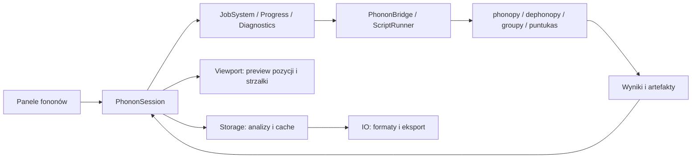

# Fonony, embedding i wizualizacja modów — projekt modułu

Data: 2026-10-05. Status: projekt, bez implementacji.

## 1. Cel i zakres

Jeden moduł prowadzi od struktury i generacji przesunięć, przez import sił i stałe siłowe, do analizy oraz wizualizacji fononów. Obejmuje fonony bulk i defektu, embedding stałych siłowych, animację modów, strzałki przemieszczeń, irrepy, IPR, dyspersję i DOS. Konfigurowalne skrypty Python obsługują analizę i przekształcenia danych; C++ odpowiada za interakcję, prezentację, renderer i cykl życia zadań.

Embedding oznacza tutaj osadzanie lokalnych zmian stałych siłowych defektu w większym modelu bulk. Nie chodzi o embedding uczenia maszynowego ani umieszczanie obcego okna aplikacji w UI.

Zachować istniejące JobSystem, ScriptRunner, EventBus, Commands, Undo, ProgressTracking, Capabilities, Diagnostics i mechanizmy projektu. Nie tworzyć własnego solvera fononów, nowego schedulera ani drugiego renderera Python w aplikacji.

## 2. Co zweryfikowano w bibliotekach

Sprawdzono graf projektu, kontrakty istniejącego renderera i bridge’ów oraz publiczne sygnatury, docstringi i metadane zainstalowanych pakietów. Nie wykonano obliczeń na rzeczywistym zbiorze fononowym. Context7 nie był dostępny w tej sesji; dla phonopy wykorzystano oficjalną dokumentację, dla lokalnych bibliotek introspekcję publicznego API, bez czytania kodu Vendor.

| Biblioteka | Stan i potwierdzony zakres | Rola w module |
|---|---|---|
| `dephonopy 0.0.0` | Są moduły `phonons`, `force_constants`, `displacements`, `embedding`, `hr_factors`, `jahn_teller`, `matrix_storage`. Import funkcjonalnych modułów zatrzymuje się na brakującym `lxml`; pojawia się też komunikat o nieudanej inicjalizacji MPI | Kandydat do embeddingu i analizy fononów defektu; integracja wymaga osobnej walidacji środowiska i API |
| `groupy-symmetry 0.1.0` | `PointGroup`, `RepresentationNum`, `RepresentationSymb`, generatory reprezentacji, redukcja i uogólnione operatory projekcji | Redukcja reprezentacji przemieszczeń i klasyfikacja symetrii lokalnej/Γ |
| `puntukas 0.0.1` | `Atoms.to_phonopy_atoms()`, `from_phonopy_atoms()`, `displacements_from()`, pola skalarne oraz publiczne API wizualizacji | Struktury, konwersje, część analiz wibronicznych i wzorce UX |
| `phonopy` | Oficjalnie udokumentowane generowanie przesunięć, FC, mody, dyspersja, DOS, irrepy, NAC i właściwości termodynamiczne | Podstawowy silnik harmoniczny i interoperacyjność |

### 2.1 dephonopy: potwierdzone moduły, niepotwierdzone kontrakty

Inwentaryzacja nazw modułów:

- `embedding`: `atoms`, `bulk_fc`, `defect_fc`, `mpi_embedding`, `mpi_slepc_embedding`, `benchmarks`.
- `force_constants`: `base`, `bulk_force_constants`, `descriptors`, `fc`, `fc_io`, `mpi_matrix`, `storage`.
- `phonons`: `base`, `bulk_phonons`, `defect_phonons`.
- `displacements`: `development`, `disp_yaml`, `displacements`, `ordered_dict_loader`.
- `matrix_storage`: warianty serial, HDF5, ScaLAPACK i SLEPc w nazwach modułów.

Nazwy wskazują miejsca do integracji; nie dowodzą poprawności, dostępności backendu ani konkretnych sygnatur. Nie deklarujemy jeszcze, że dephonopy ma działający interfejs do IPR, irrepów lub animacji.

Metadane dephonopy deklarują `numpy`, `phonopy`, `ase`, `PyYAML`, `h5py`, ale import wymaga też `lxml`. Trzeba ustalić właściwe zależności i dostępność ścieżki serial na Windows. Sam komunikat MPI nie dowodzi, że wszystkie obliczenia wymagają MPI; wymaga sprawdzenia po usunięciu pierwszego blokera.

**Etap integracyjny przed wdrożeniem:** działający import, mały serialny test FC i modów, identyfikacja publicznego API embeddingu, mapowania atomów i formatów, następnie opcjonalne backendy MPI/SLEPc. Nie instalowano zależności ani nie zmieniano bibliotek podczas planowania.

### 2.2 groupy

Potwierdzono `RepresentationSymb.reduce()` i `generalized_projection_operator()`. Istniejący skrypt `scripts/python/examples/groupy_point_group_analysis.py` oraz bridge teorii grup stanowią wzorce transportu charakterów, etykiet i orientacji układu.

Reprezentacja fononowa wymaga permutacji atomów **oraz obrotu ich trzech składowych wektorowych**. Sama redukcja skalarnej reprezentacji miejsc z istniejącego panelu nie klasyfikuje drgań. Dla okresowych operacji poza Γ trzeba uwzględnić translacje i fazy Blocha.

Groupy nie został potwierdzony jako kompletny silnik irrepów grup przestrzennych przy dowolnym q. Dla takich przypadków podstawą pozostaje phonopy; nie nadawać etykiet grupy punktowej Γ wszystkim punktom dyspersji.

### 2.3 puntukas-tools2

Potwierdzone konwersje zachowują jawnie ustawione masy, co ma znaczenie dla częstotliwości i izotopów. PhonopyAtoms jest strukturą okresową w trzech kierunkach; konwersja nie rozwiązuje automatycznie przypadku molekuły lub materiału 2D.

`displacements_from()` obsługuje przemieszczenia przy zgodnej kolejności atomów. Nie zastępuje mapowania atomów między strukturami o innej kolejności lub składzie.

W `puntukas.vibronic.harmonic` potwierdzono `huang_rhys`, `harmonic_overlaps`, `harmonic_model`. Są to narzędzia harmoniczne do współrzędnej konfiguracyjnej i nakładania funkcji wibracyjnych, nie pełny workflow fononów bulk. Docstringi wymagają częstotliwości w jednostkach atomowych i masowo ważonego przesunięcia; adapter musi wykonać jawne konwersje.

Nie potwierdzono dedykowanego odtwarzacza fononów ani warstwy strzałek fononowych w sprawdzonym publicznym API wizualizacji puntukas. Istniejąca wizualizacja pozostaje źródłem inspiracji, nie gotowym substytutem modułu.

## 3. Inspiracje z wizualizacji puntukas

Potwierdzone API obejmuje `Scene`, `AtomsLayer`, `BondsLayer`, `CellLayer`, `LabelsLayer`, `IsosurfaceLayer`, `SliceLayer`, style materiałów i elementów oraz okno `StructureWindow`.

Wzorce do wykorzystania w natywnym UI:

| Wzorzec puntukas | Zastosowanie w Defect Studio |
|---|---|
| Warstwy sceny, oddzielna widoczność i usuwanie | Niezależne atomy, strzałki, pozycje równowagowe, trajektorie i obszary embeddingu |
| Kamera zapisywana i przywracana | Zmiana modu nie resetuje widoku; porównania mogą współdzielić kamerę |
| Jakość `fast` i `pretty`, lepszy screenshot | Płynna animacja i niezależna jakość eksportu |
| Parametry atomów i wiązań rozdzielone | Rozmiar sfer nie zmienia kryterium wiązań |
| Wiązania z przesunięciami obrazów okresowych | Ruch atomów nie tworzy linii przez całą superkomórkę |
| Lattice axes a/b/c i osobne osie kartezjańskie | Czytelna orientacja w komórkach skośnych |
| Wspólna zmiana danych warstwy, bez mnożenia zakładek | Wybrany mod aktualizuje jeden podgląd |
| Mały LRU i analiza kosztownych pól po wyborze wiersza | Lazy loading wektorów modów, bez wczytywania wszystkich eigenwektorów |
| Stałe ustawienia wyświetlania przy zmianie stanu | Przełączenie modu nie resetuje amplitudy, kolorów i kamery |

Nie przenosić Qt/PyVista/VTK do natywnego UI. Wykorzystać istniejący renderer OpenGL i jego instancjonowanie. Ewentualny zewnętrzny viewer Python może być dodatkiem diagnostycznym, ale nie wymaganiem podstawowej obsługi.

## 4. Model danych i poprawność fizyczna

### 4.1 Dane domenowe

Proponowane wartościowe typy:

- `PhononDataset`: ID, struktura, masy, PBC, komórki, mapowania atomów i obrazy translacyjne, źródła, wersje i jednostki.
- `ForceConstantsDescriptor`: FC2, pełny/compact/sparse format, kształt, jednostka, mapowania, URI danych, fingerprint.
- `PhononModeSummary`: q, indeks gałęzi, częstotliwość, stabilność, IPR/PR, irrep i degeneracja, udział atomów/regionu.
- `PhononModeVectors`: zespolone eigenwektory, konwencja fazy i normalizacji, mapowanie na atomy.
- `DisplacementPlan`: parametry generacji, nieprzesunięta referencja, lista struktur i identyfikatory zadań.
- `EmbeddingRecipe`: bulk, defekt, komórka docelowa, mapowania, maski, promienie i reguła składania FC.
- `PhononAnalysisResult`: wynik, diagnostyka, provenance i referencje do ciężkich danych.

Mode ID obejmuje dataset, q, indeks i rewizję solvera. Po zmianie FC indeks nie jest trwałą tożsamością fizyczną modu. Dopasowanie modów między zbiorami wymaga nakładania eigenwektorów/podprzestrzeni, nie samej kolejności częstotliwości.

Obliczenia: float64/complex128. Bufory renderera: float32 po walidacji. Częstotliwość przechowywana w jednej jawnej konwencji, prezentacja w THz, cm⁻¹ lub meV z poprawnymi konwersjami między f, ω i energią.

### 4.2 Ruch atomów

Eigenwektor macierzy dynamicznej nie jest bezpośrednio przesunięciem w Å. Fizyczny względny wzorzec ruchu uwzględnia masy:

```text
u(l,k,t) ∝ Re[(e(k,q,ν) / sqrt(m_k)) * exp(i * phase(l,k,q) - i * θ(t))]
r(l,k,t) = r0(l,k) + A * u(l,k,t)
```

Fazę przestrzenną należy zbudować zgodnie z konwencją konkretnego solvera; nie dodawać ponownie fazy bazy atomowej, jeśli jest już uwzględniona w eigenwektorach. Adapter wymaga testu na znanym modzie przy q ≠ Γ.

W normalnym podglądzie parametr A jest wizualną amplitudą, np. maksymalnym przemieszczeniem 0.15 Å. Nie jest automatycznie amplitudą termiczną. Szybkość odtwarzania w cyklach/s jest parametrem prezentacji, nie rzeczywistą częstotliwością THz. Opcjonalne amplitudy termiczne/kwantowe wymagają oddzielnego modelu i wykluczenia modów zerowych/niestabilnych.

Dla q ≠ Γ umożliwić zespolone trajektorie i fazy między komórkami. Ukończona okresowa animacja superkomórki wymaga komensuratywnego q; w przeciwnym przypadku oznaczyć podgląd jako skończony fragment fali bez okresowego domknięcia.

Mody urojone pokazywać jako niestabilności z ujemnym ω²; nie traktować ich jako zwykłych harmonicznych oscylacji. Podgląd kierunku niestabilności może oscylować dydaktycznie, ale musi być tak nazwany.

### 4.3 IPR i participation ratio

Domyślny atomowy udział eigenwektora:

```text
w_k = sum_alpha |e(k,alpha)|²
p_k = w_k / sum_j w_j
IPR = sum_k p_k²
N_eff = 1 / IPR
PR = 1 / (N * IPR)
```

Jednakowe udziały na N atomach dają IPR=1/N, PR=1; jeden atom daje IPR=1, N_eff=1. Osobna opcja „udział przemieszczenia” używa e/sqrt(m); zapisać definicję w wyniku i etykiecie. Nie reużyć orbitalnego IPR pola skalarnego jako fononowego IPR.

Wartości porównywać przy tej samej konwencji i wielkości układu. Dla modów Blocha primitive-cell IPR opisuje udziały w bazie, a nie lokalizację defektu w dużej superkomórce. Dla degeneracji IPR pojedynczego wektora zależy od wyboru bazy; pokazać też udziały całej podprzestrzeni jako wynik niezależny od jej obrotu. Dowolne maksymalizowanie lokalizacji jest dodatkową analizą, nie niezmiennikiem.

## 5. Workflow przyjazny użytkownikowi

Trzy punkty wejścia:

1. „Mam wyniki fononowe” — import i natychmiastowa tabela/wykres dostępnych danych.
2. „Chcę przygotować obliczenia” — kreator przesunięć i katalogów.
3. „Chcę osadzić defekt w większej komórce” — kreator embeddingu z mapowaniami i podglądem obszarów.

Jeden `PhononSession` udostępnia dane wszystkim panelom. Widok struktury, tabela i wykresy mają wspólny wybór modu; sesja jest przypięta do analizy i viewportu, nie zmienia celu po przypadkowym refocus.

Główne zakładki: **Dane / Mody / Widmo / Stałe siłowe / Przesunięcia / Embedding / Skrypty**. Podstawowy układ: tabela lub wykres po lewej, istniejący viewport po prawej, krótki pasek odtwarzania poniżej. Szczegóły numeryczne w rozwijanym obszarze.

Stany UI: „brak danych”, „wczytywanie”, „częściowe dane”, „gotowe”, „nieaktualne”, „błąd”. Brak eigenwektorów nie blokuje wykresu częstotliwości; brak BORN nie blokuje całego importu, ale NAC jest niedostępne. Informacja o niedostępności wyjaśnia brakujące wejście i następną czynność.

Presety: „Przegląd”, „Mody defektowe”, „Symetria”, „Publikacja”. Zachować własne ustawienia; preset nie nadpisuje danych naukowych.

## 6. Mody, animacja i strzałki

### 6.1 Tabela i interakcja

Kolumny: numer, q, częstotliwość, irrep, wymiar degeneracji, IPR, PR/N_eff, udział regionu defektu, stabilność. Filtry zakresu częstotliwości, irrep, lokalizacja, atomy/elementy/region, mody niestabilne. Sortowanie i wielokrotny wybór; kliknięcie wybiera mod i aktualizuje viewport.

Informacja o modzie: jednostki, masy, atomy o największym udziale, dane źródłowe, normalizacja, tolerancje. „Pokaż dominujące atomy” i „Wycentruj na defekcie” jako krótkie akcje.

### 6.2 Sterowanie animacją

- Play/pause, stop do położeń równowagowych, krok i suwak fazy 0–360°.
- Amplituda w Å, auto-scale do zadanego maksymalnego ruchu, reset.
- Szybkość w cyklach/s, odwrócenie kierunku fazy.
- Pozycje równowagowe jako ghost, trajektorie liniowe/eliptyczne, widoczne komórki obrazowe.
- Kamera i zaznaczenie zachowane przy zmianie modu.
- Zamrożenie fazy do screenshotu i jawny eksport przesuniętej struktury.
- Przy porównaniu dwóch modów: wspólna faza i kamera, jawnie wspólna albo osobna skala amplitudy.

Mieszanie modów z amplitudą i fazą każdego składnika jako rozszerzenie. Nie wymuszać osobnego odtwarzania Python dla każdej klatki.

### 6.3 Strzałki

Tryby: chwilowe przemieszczenie, chwilowa prędkość, maksymalna amplituda/polaryzacja. Etykieta i legenda wskazują aktualne znaczenie. Dla zespolonej polaryzacji pokazać orbitę lub przekrój w konkretnej fazie, nie jeden arbitralny wektor jako kompletny ruch.

Ustawienia:

- Niezależny mnożnik długości strzałek i amplituda ruchu atomów.
- Skala wspólna zachowująca proporcje oraz tryb jednakowych długości pokazujący tylko kierunki; ten drugi jawnie opisany.
- Grubość trzonu, długość/szerokość grotu, typ grotu z istniejącego słownika stylów, przezroczystość.
- Kolor stały, według elementu, udziału w modzie lub wielkości przemieszczenia.
- Stały zakres skali kolorów albo normalizacja do widocznych atomów; legenda.
- Minimum udziału, maksymalna liczba strzałek, tylko zaznaczone/widoczne atomy lub region.
- Zakotwiczenie w położeniu równowagowym albo aktualnym; przesunięcie początku do powierzchni sfery.
- Opcjonalne strzałki dwukierunkowe dla modów rzeczywistych, reprezentujące ±amplitudę.
- Domyślne testowanie głębokości; opcjonalny overlay z jasnym wskazaniem tego trybu.

Skalowanie strzałek nie zmienia eigenwektorów, IPR ani eksportowanych FC. Zerowe wektory nie generują grotów; krótkie groty są ograniczane, aby nie odwracały wizualnego kierunku.

### 6.4 Renderer

Istnieją `DisplacementComparisonState` i instancjonowany `renderDisplacementArrows` z cylindrami i stożkami. Reużyć pass i dane instancji po sprawdzeniu ich wejść; nie tworzyć ScenePath dla każdego atomu i każdej klatki. Semantykę porównania dwóch struktur zachować oddzielnie od modów, współdzielić geometrię/style i rendering.

Animacja używa nakładki pozycji podglądowych, nie modyfikuje CrystalStructure ani undo przy każdej klatce. Po zakończeniu wraca do r0; eksplicitny „Zapisz przesuniętą strukturę” tworzy nowy artefakt lub komendę. Picking, etykiety, wiązania i eksport muszą korzystać z tej samej pozycji podglądu.

Wiązania: domyślnie stała topologia z geometrii równowagowej, aktualizowane końce i obrazy okresowe. Redetekcja co klatkę jest kosztowna i powoduje migotanie. Małe amplitudy i nieowijane współrzędne zapobiegają skokom przez granicę komórki.

## 7. Irrepy i degeneracje

Klasyfikacja Γ: grupa punktowa struktury lub jawnie wskazana grupa lokalna, permutacje atomów, wektorowa reprezentacja 3N i projekcja modów/podprzestrzeni. Dla molekuł rozdzielić translacje/rotacje od drgań; dla kryształu sprawdzić trzy mody akustyczne Γ. Dla lokalnego klastra etykieta nie oznacza irrep całego kryształu.

Przy ogólnym q: właściwa mała grupa, translacje, fazy i dane symetrii z silnika phonopy. Pokazać punkt q i grupę używaną do etykietowania. Brak jednoznacznej etykiety jest prawidłowym wynikiem; nie wymuszać najbliższej nazwy.

Degeneracje grupować tolerancją częstotliwości i sprawdzać niezmienniczość podprzestrzeni. Nie etykietować arbitralnego pojedynczego wektora w zdegenerowanym zbiorze bez projekcji. Zapisać tolerancje, frame, operacje symetrii i ewentualne naruszenie symetrii FC.

Aktywność IR/Raman można wyznaczać z symetrii przy odpowiednich założeniach. **Aktywność nie jest intensywnością.** Intensywności wymagają dodatkowych pochodnych dipola/polaryzowalności lub danych efektywnych ładunków i odpowiedniego modelu. Przewidzieć te wejścia jako rozszerzenie.

## 8. Widmo fononowe

Zakres podstawowy:

- Dyspersja bulk wzdłuż ścieżki q; kliknięcie gałęzi wybiera q i mod.
- Total DOS i projected DOS według elementu, atomów, kierunku i regionu.
- Dla defektu: dyskretne mody, DOS z wybraną szerokością oraz IPR względem częstotliwości.
- Kolorowanie dyspersji/mode scatter przez udział atomów lub lokalizację.
- Jednostki THz/cm⁻¹/meV; jawne szerokości broadenigu, normalizacja i wagi q.
- Ujemne częstotliwości jako konwencja wyświetlania modów urojonych, nie ukryte wartości bezwzględne.

DOS, widmo IR, Raman, neutronowe i widmo wibroniczne to różne wielkości. UI ma osobne typy wykresów i nie nazywa dowolnego histogramu „widmem Raman”. Widma intensywności są dostępne dopiero z właściwymi wejściami.

Rozszerzenia: właściwości termodynamiczne, zero-point energy, F(T), S(T), Cv(T), przemieszczenia termiczne, dynamic structure factor, Huang–Rhys S_k, funkcja spektralna, Debye–Waller i sidebandy. IR/Raman i analizy wibroniczne mają oddzielne walidacje jednostek oraz wymaganych danych.

Nie interpretować Γ dużej superkomórki defektowej jako pełnej dyspersji bulk. Unfolding/projected spectral function stanowi osobną funkcję po MVP.

## 9. Generowanie przesunięć i obliczeń

Kreator: struktura równowagowa → supercell/primitive matrix → parametry przesunięć → podgląd liczby obliczeń → zapis zestawu.

Parametry: amplituda w Å, ±przesunięcia, redukcja symetrią, symprec, masy, pełna macierz superkomórki, backend calculatora. Generacja standardowa przez phonopy; random displacements i symfc jako opcja po sprawdzeniu dostępności.

Podgląd zawiera atom/kierunek, zmianę położenia, etykietę katalogu, liczbę konfiguracji, szacowany rozmiar. Zachować referencję nieprzesuniętą do diagnostyki sił resztkowych. Struktury do obliczenia sił mają zwykle stałą komórkę i pozycje — nie uruchamiać relaksacji, która usunie zamierzone przesunięcia.

Zapisać manifest zestawu z ID, strukturą i fingerprintem, mapowaniami, amplitudą, symetrią, seedem, ścieżkami i statusem. Powiązać wyniki sił z ID oraz sprawdzić atomy/komórkę/przesunięcia; nie przypisywać wyłącznie po alfabetycznej kolejności katalogów.

Obsługa: utwórz wejścia → użytkownik wykonuje DFT → import wyników → tabela ukończone/brakujące/błędne → fit FC. Eksport wejść nie oznacza automatycznego wysyłania zadań na klaster. Reużyć istniejące generowanie struktur i plików wejściowych, bez nowego frameworka submittera.

Importy: phonopy.yaml/phonopy_disp.yaml, FORCE_SETS, FORCE_CONSTANTS, force_constants.hdf5, BORN, wybrane wyniki VASP. Zakres innych kalkulatorów zależy od dostępnego parsera. Sam band.yaml może wystarczyć do wykresu, ale niekoniecznie do przebudowania FC i wszystkich analiz.

## 10. Stałe siłowe i konfigurowalne skrypty Python

Podstawowy inspector: bloki Φ_ij 3×3, normy, odległości, elementy i obrazy komórek; heatmapa wybranych bloków, radialny spadek oddziaływań, graf silnych sprzężeń. Nie wczytywać całej gęstej macierzy do ImGui tylko dla tabeli.

Diagnostyka:

- Symetria par Φ_ij = Φ_jiᵀ i hermitowskość D(q).
- Acoustic sum rule, trzy mody akustyczne Γ, opcjonalne rotational sum rules.
- Zgodność z symetrią kryształu i mapowaniami compact/full.
- Resztkowe siły, drift, jakość fitu, kompletność zbioru przesunięć.
- Zbieżność amplitudy przesunięcia i rozmiaru superkomórki.
- Wartości przed/po symetryzacji, korekcie ASR i cutoffie.

Transformacje nie nadpisują surowego źródła. Wynik operacji ma nowy fingerprint i raport wpływu na częstotliwości. Automatyczna korekta nie usuwa diagnostyki błędu danych.

### 10.1 Kontrakt skryptów

Reużyć PythonScriptJob, ScriptRunner i panel konsoli. Początkowo prosty zestaw skryptów i JSON konfiguracji, bez systemu pluginów z dynamicznymi fabrykami.

```text
request.json:
  schemaVersion, operation, inputArtifacts, parameters, outputDirectory

result.json:
  schemaVersion, status, summary, diagnostics,
  tables, plots, outputArtifacts, provenance
```

Każdy skrypt ma ID, nazwę, wersję, opis wymaganych wejść i schemat parametrów. UI generuje podstawowe pola number/enum/bool/path i pokazuje jednostki; zaawansowane opcje mogą pozostać w JSON. Logi na stderr lub w osobnym pliku, stdout dla ustalonego kontraktu wyniku.

FC i duże tablice przez HDF5/NPY; małe tabele i metadane przez JSON. C++ nie musi linkować HDF5, jeśli całą selekcję bloków wykonuje Python. Format transportowy do renderera: metadane i binarny bufor o jawnym dtype/order.

Skrypt działa w katalogu zadania, wynik publikowany atomowo po walidacji. Zapisać hash treści skryptu, parametry i wersje środowiska. Dopuszczać skrypty wybrane przez użytkownika; nie uruchamiać automatycznie znalezionych plików .py podczas importu datasetu. To rzeczywiste wykonanie kodu, nie sandbox gwarantowany przez sam subprocess.

Domyślne analizy: jakość FC, ASR, symetryzacja, profile sprzężeń, porównanie bulk/defect, analiza IPR, convergence report. Kosztowny fit i diagonalizacja jako joby z anulowaniem i postępem.

## 11. Embedding stałych siłowych

Kreator:

1. Wybierz FC i strukturę bulk oraz FC i strukturę defektu.
2. Zbuduj komórkę docelową i jawne mapowanie atomów/obrazów.
3. Wskaż środek defektu, region lokalny i regułę zastępowania lub dodawania zmian FC.
4. Pokaż obszary, atomy niemapowalne, zmianę składu, bloki i interfejs.
5. Waliduj i oszacuj rozmiar pamięci.
6. Zbuduj FC embedded, sprawdź sum rules i oblicz wybrany zakres modów.

Reużyć dephonopy po potwierdzeniu kontraktu. Prosta recepta Φ_emb = Φ_bulk + ΔΦ_defect może być jedną metodą, ale nie definiuje kompletnego algorytmu: trzeba ustalić mapowanie, on-site, granicę regionu, cutoff, brakujące atomy i sposób zachowania sum rules. Konkretna metoda ma nazwę, wersję i parametry.

Bulk i defekt muszą być kompatybilne pod względem jednostek, komórki referencyjnej, metody DFT i konwencji FC. Interstitial/substitution/vacancy wymagają jawnej obsługi składu i mas; brak odpowiednika atomu nie oznacza bloku zerowego bez decyzji modelu.

UI: kolory bulk/defect/boundary, suwaki regionu i maski, liczba atomów, koszt pamięci i zakres modów, porównanie wyników przed/po. Promień wizualnej maski nie zmienia recepty naukowej bez zatwierdzenia zmiany konfiguracji i przeliczenia.

Diagnostyka: symetria par, ASR, artefakty granicy, stabilność, lokalizacja modów, zależność od promienia regionu i komórki docelowej. Zapisać oddzielnie źródłowe i embedded FC oraz pełną receptę. Nie przedstawiać embeddingu jako nowych obliczeń DFT całej dużej superkomórki.

Dla dużych układów: sparse storage, ograniczony zakres własny i oszacowanie kosztu przed startem. Dense diagonalization ma pamięć O((3N)²) i koszt typowo O((3N)³); nie uruchamiać bez sprawdzenia rozmiaru. MPI/SLEPc są opcjonalnymi capability, nie warunkiem zwykłego importu i animacji.

## 12. Architektura i granice



Proponowane komponenty: model domenowy w `Domain/Phonons`, mała rodzina operacji bridge w `ScientificRuntime/Python`, jedna sesja i cienkie panele w `Presentation`, overlay ruchu w `Renderer`, parsowanie/zapis formatów w IO, własność trwałych analiz w Storage. Dokładny podział plików ustalić przy implementacji według istniejących wzorców.

C++: standard library, GLM, istniejące ImGui/ImPlot, OpenGL, nlohmann/json i YAML. Python: NumPy/SciPy, phonopy, dephonopy, groupy, puntukas, h5py i Matplotlib do eksportu. `lxml` jako zależność wymagająca naprawy deklaracji dephonopy. Symfc/SLEPc/PETSc/MPI tylko dla funkcji, które ich faktycznie potrzebują.

Joby operacyjne: import, generacja przesunięć, import sił/fit FC, obliczenie podsumowań, pobranie modów, irrepy, DOS/dyspersja, embedding, skrypt analizy i eksport. Reużyć scheduler i typy błędów. Zmienione parametry tworzą nowy request; wynik starego joba nie trafia do nowej analizy.

Animacja działa lokalnie w C++ po załadowaniu wybranego eigenwektora. Timer nie uruchamia procesów Python co klatkę. Renderowanie i aktualizacja GPU na właściwym wątku. Eksport klatek ma deterministyczną fazę niezależną od rzeczywistego czasu renderowania.

## 13. Cache, persistence i eksport

Poziomy cache: parsed structures/FC descriptors, wyniki analiz, strony eigenwektorów, bufory i geometryczne podglądy. Mały LRU ograniczony bajtami, nie tylko liczbą modów. Podsumowania wszystkich modów można trzymać w RAM; ciężkie eigenwektory czytać na żądanie. FC pozostaje na dysku lub w procesie obliczeniowym, jeśli UI potrzebuje tylko wybranych bloków.

Klucze: fingerprint źródeł, masy, mapowania, q/mesh/path, NAC i BORN, tolerancje symetrii, definicja IPR, recepta embeddingu, parametry fitu, skrypt i wersje silników. Zmiana koloru lub skali strzałki nie unieważnia diagonalizacji. Zmiana mas/FC unieważnia mody i analizy pochodne.

Trwały zapis: konfiguracja analizy, recepty, wyniki podsumowań, diagnostyka, referencje i provenance; ustawienia widoku, kamery, amplitudy i stylu osobno. Surowe dane nigdy nie zastępowane cache. Dataset niedostępny po przeniesieniu projektu może pokazać historyczne wyniki z oznaczeniem i możliwością relink.

Schematy mają wersję, zapisy atomowe i czytelne statusy incomplete/complete/stale. Hash treści do odtwarzalności, rozmiar/mtime jako szybkie sprawdzenie. Import nie uruchamia ukrytego przeliczania całego DOS.

Eksport: CSV/JSON podsumowań i IPR, phonopy-compatible artefakty tam, gdzie dostępne, PNG/SVG/PDF wykresów, screenshot, XYZ trajektorii, zestaw klatek. MP4/GIF opcjonalne po wykryciu enkodera, bez obowiązkowej nowej zależności. Dołącz metadane: mod, q, częstotliwość, skala wizualna, metoda, normalizacja i kamera.

## 14. Uzupełnienia do pierwotnego zakresu

W projekcie powinny znaleźć się również:

- Masy i izotopy, jednostki i konwencje eigenwektorów.
- Mapowania primitive/supercell/defect i okresowe obrazy atomów.
- Mody akustyczne/zerowe, niestabilności i ASR.
- NAC/LO–TO, Born effective charges, dielektryk elektroniczny i kierunek granicy q→0.
- Degeneracje, zespolone wektory, ciągłość gałęzi i porównywanie podprzestrzeni.
- PDOS i udziały regionu defektu oraz definicje IPR/PR.
- Kontrola zbieżności amplitudy, komórki, q-mesh i promienia embeddingu.
- Rozróżnienie DOS, intensywności spektroskopowych i funkcji spektralnej wibronicznej.
- Eksport odtwarzalnej animacji, provenance, relink i limity pamięci.
- Opcjonalna termodynamika, Huang–Rhys/Debye–Waller, Duschinsky i nakładanie modów między stanami.

Anharmoniczność, FC3, przewodnictwo cieplne/phono3py, QHA, unfolding i złożone modele Jahn–Teller są rozszerzeniami. Nie przedstawiać ich jako funkcji gotowych tylko dlatego, że istnieje podobna nazwa modułu w bibliotece.

## 15. Etapy wdrożenia i odbiór

1. **Walidacja integracji:** środowisko dephonopy, importy, serial backend, mały przypadek phonopy, mapowania i jednostki. Zidentyfikować publiczne API embeddingu bez zgadywania.
2. **Viewer:** import częstotliwości i wybranych eigenwektorów, tabela, animacja Γ, kontrolowane strzałki, screenshot i zapis ustawień.
3. **Analiza:** IPR/PR, regiony, degeneracje i irrepy Γ, DOS/PDOS oraz q≠Γ z przetestowanymi fazami.
4. **Przygotowanie obliczeń:** kreator przesunięć, manifest, import sił, fit FC i diagnostyka/skrypty.
5. **Embedding:** działający mały przypadek, podgląd regionów, raport zbieżności, potem duże sparse/MPI przypadki.
6. **Rozszerzenia:** dyspersja i NAC tam, gdzie dane dostępne, termodynamika, widma intensywności i wibronika.

### Minimalne sprawdzenia naukowe

- Znany układ harmoniczny: poprawne częstotliwości, wpływ mas i jednostki.
- Trzy translacyjne mody Γ oraz ASR przed/po korekcie.
- IPR dla jednego atomu i jednakowego udziału N atomów; niezmienność na skalowanie i fazę.
- Wynik podprzestrzeni niezależny od obrotu bazy degeneracji.
- Poprawna redukcja 3N dla znanej symetrii, brak fałszywej etykiety po jej złamaniu.
- Komensuratywny q i znany wzorzec faz między komórkami.
- Compact/full FC oraz mapowania po zmianie kolejności atomów.
- Embedding bez ΔΦ odtwarza model bulk; granica i sum rules mają raport.
- Porównanie z referencyjnym wynikiem biblioteki, nie tylko test roundtrip JSON.

### Minimalne sprawdzenia produktu

- Zmiana modu zachowuje kamerę i ustawienia; stop odtwarza r0.
- Animacja nie zmienia struktury naukowej i nie zapełnia undo.
- Strzałki zerowe/krótkie, ukryte atomy, PBC i picking działają spójnie.
- Brak eigenwektorów nie blokuje dostępnych wykresów.
- Anulowanie kończy proces; spóźniony wynik nie zastępuje nowej analizy.
- Pamięć jest ograniczona przy przeglądaniu wielu modów.
- Cache unieważnia się po zmianie FC, mas i skryptu.
- Wyniki, ustawienia i provenance przechodzą save/load; brakujące źródła można relinkować.

## Źródła

- [Phonopy API](https://phonopy.github.io/phonopy/phonopy-module.html) — podstawowe workflow i operacje.
- [Phonopy formulations](https://phonopy.github.io/phonopy/formulation.html) — FC, macierz dynamiczna, masy, fazy i NAC.
- [Phonopy input files](https://phonopy.github.io/phonopy/input-files.html) — formaty i compact/full FC.
- [Phonopy setting tags](https://phonopy.github.io/phonopy/setting-tags.html) — konfiguracja i animacje/modulacje.
- [Random displacements](https://phonopy.github.io/phonopy/random-displacements.html) — generacja losowych konfiguracji.
- [Symmetry-adapted modes](https://phonopy.github.io/phonopy/symmetry-adapted-modes.html) — podprzestrzenie symetrii.
- [Dynamic structure factor](https://phonopy.github.io/phonopy/dynamic-structure-factor.html) — odrębna wielkość spektroskopowa.
- Lokalne publiczne API bibliotek introspektowane 2026-10-05; ich niezweryfikowane możliwości wskazano jawnie powyżej.

Dokumentacja online phonopy obejmowała wersje nowsze od potencjalnie zainstalowanej. Implementacja musi przypiąć wersję i zweryfikować sygnatury; plan nie zakłada automatycznej zgodności wszystkich nowych opcji.
